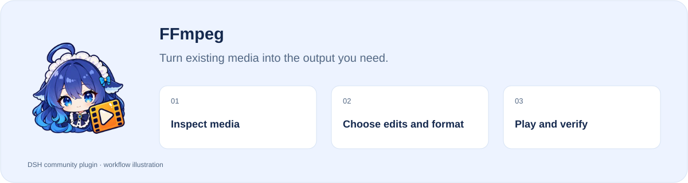

[简体中文](README.md) · **English**

# FFmpeg

**Turn existing media into the output you need.**

Local FFmpeg media plugin for DeepSeek Harness (`>=0.2.2-rc.3`): handles media probing, trimming, concatenation, preset transcoding, subtitle burn-in, storyboard extraction, and GIF export with Windows-safe filter path escaping.

[](https://www.npmjs.com/package/dsh-ffmpeg) [](https://www.npmjs.com/package/dsh-ffmpeg) [](https://www.npmjs.com/package/dsh-ffmpeg)

**[Install](#install) · [Workflow](#start-using-it) · [Full guide](https://github.com/STARDUSTLC666/dsh-ffmpeg/blob/master/docs/REFERENCE.en.md)**

<picture>
  <source media="(prefers-color-scheme: dark) and (max-width: 640px)" srcset="https://raw.githubusercontent.com/STARDUSTLC666/dsh-ffmpeg/master/docs/assets/intro/workflow-en-mobile-dark.svg">
  <source media="(max-width: 640px)" srcset="https://raw.githubusercontent.com/STARDUSTLC666/dsh-ffmpeg/master/docs/assets/intro/workflow-en-mobile-light.svg">
  <source media="(prefers-color-scheme: dark)" srcset="https://raw.githubusercontent.com/STARDUSTLC666/dsh-ffmpeg/master/docs/assets/intro/workflow-en-dark.svg">
  
</picture>

## Features

- Inspect media parameters and timestamped contact sheets.
- Trim, join, transcode, add subtitles or extract frames.
- Keep the source and play the output before delivery.

## Install

Open **Plugins** in the DSH desktop app and install `dsh-ffmpeg`. If the CLI is available:

```bash
dsh plugin --profile desktop add dsh-ffmpeg
```

For the web profile, replace `desktop` with `web`. Restart that DSH profile after installation. The package’s DSH requirement is `>=0.2.2-rc.3`.

## Start using it

No need to memorize raw FFmpeg flags — follow three natural steps:

1. **Check setup & drop media**: Ensure `ffmpeg` and `ffprobe` are installed locally (ask *"Check whether FFmpeg is ready"* if unsure) and place your video, audio, or `.srt` subtitle files in the workspace.
2. **Preview timestamps visually (great for long recordings)**: When you don't know exact cut points, ask for a **timestamped contact sheet** first so you can pick start/end times visually.
3. **Describe the outcome & play back**: Ask in plain language to trim, join, compress, burn in subtitles, extract frames, or export a GIF. Original source files are never overwritten; open and play the output path to confirm video and audio.

Ready-to-copy prompts:

- **Find cut points**: `Generate a timestamped contact sheet for demo.mp4 first so I can pick which segment to keep.`
- **Trim & compress**: `Trim 01:15 to 03:40 from recording.mp4 and encode a compact 1080p MP4 for sharing, keeping the original file.`
- **Burn subtitles & make a GIF**: `Burn subtitles.srt into talk.mp4, and export the first 6 seconds as a smooth preview GIF.`

## Before you start

Requires local FFmpeg/ffprobe and access to the input and output locations.

Configuration, detailed tools and troubleshooting: [full reference](https://github.com/STARDUSTLC666/dsh-ffmpeg/blob/master/docs/REFERENCE.en.md).

## Plugin updates

Check updates at the bottom of the workbench or native plugin details. Automatic checks are on by default; **automatic installation is off**. You choose whether to install and when to restart. Suite-managed components update with their bundle. [Update behavior](https://github.com/STARDUSTLC666/dsh-ffmpeg/blob/master/docs/REFERENCE.en.md).

## Documentation

- [Full usage, configuration and limits](https://github.com/STARDUSTLC666/dsh-ffmpeg/blob/master/docs/REFERENCE.en.md)
- [Release notes](https://github.com/STARDUSTLC666/dsh-ffmpeg/blob/master/CHANGELOG.md)
- [Validation scope and history](https://github.com/STARDUSTLC666/dsh-ffmpeg/blob/master/docs/VALIDATION.md)

## Feedback and contributions

If the plugin helps, a Star makes it easier for others to discover. Report problems or suggest improvements in [Issues](https://github.com/STARDUSTLC666/dsh-ffmpeg/issues); code and documentation [PRs](https://github.com/STARDUSTLC666/dsh-ffmpeg/pulls) are welcome. Include versions and reproduction steps, and remove credentials from reports.

## License

[MIT](https://github.com/STARDUSTLC666/dsh-ffmpeg/blob/master/LICENSE)

<a id="what-it-does"></a>
<a id="requirements-and-configuration"></a>
