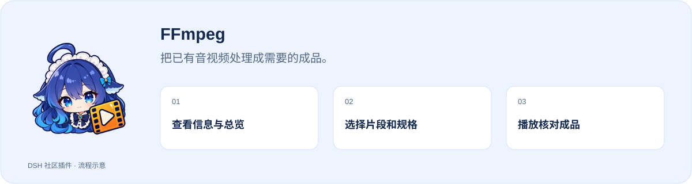

**简体中文** · [English](README.en.md)

# FFmpeg

> **不用记 FFmpeg 复杂参数，一句话把音视频处理成所需成品。**

DeepSeek Harness（`>=0.2.2-rc.3`）本机音视频处理插件：封装 FFmpeg / FFprobe 常用操作，兼容 Windows 滤镜路径转义，并默认绝不覆盖源文件。

[](https://www.npmjs.com/package/dsh-ffmpeg) [](https://www.npmjs.com/package/dsh-ffmpeg) [](https://www.npmjs.com/package/dsh-ffmpeg)

**[核心能力](#核心能力) · [安装](#安装) · [快速上手](#开始使用) · [完整说明](https://github.com/STARDUSTLC666/dsh-ffmpeg/blob/master/docs/REFERENCE.zh.md)**

<picture>
  <source media="(prefers-color-scheme: dark) and (max-width: 640px)" srcset="https://raw.githubusercontent.com/STARDUSTLC666/dsh-ffmpeg/master/docs/assets/intro/workflow-zh-mobile-dark.svg">
  <source media="(max-width: 640px)" srcset="https://raw.githubusercontent.com/STARDUSTLC666/dsh-ffmpeg/master/docs/assets/intro/workflow-zh-mobile-light.svg">
  <source media="(prefers-color-scheme: dark)" srcset="https://raw.githubusercontent.com/STARDUSTLC666/dsh-ffmpeg/master/docs/assets/intro/workflow-zh-dark.svg">
  
</picture>

## 核心能力

| 能力 | 说明 |
| :--- | :--- |
| **媒体探测与总览图** | 读取分辨率、码率、音视频轨参数；生成带时间戳的**分镜总览图**，先看画面再决定剪哪段 |
| **剪辑、拼接与转码** | 精准时间段裁切、多片段拼接，以及面向微信/网页分享的预设 H.264/压缩转码 |
| **字幕、抽帧与 GIF** | 烧录 `.srt`/`.ass` 字幕（兼容 Windows 路径转义）、提取指定帧画面与导出清晰动图 GIF |
| **画面与声音调节** | 支持倍速调节、音量增益/衰减、一键静音与 90°/180°/270° 旋转，默认保留原文件不覆盖 |

## 安装

在 DSH 桌面版「插件」面板安装 `dsh-ffmpeg`，或使用命令行：

```bash
dsh plugin --profile desktop add dsh-ffmpeg
```

网页版将 `desktop` 改为 `web`，安装后重启 DSH。宿主要求：`>=0.2.2-rc.3`。

## 开始使用

1. **检查环境与放入素材**：确认本机已安装 `ffmpeg` / `ffprobe`（可先问助手「检查一下 FFmpeg 环境能用吗」），将素材放进当前工作区。
2. **先看分镜总览图（长视频推荐）**：记不清时间点时，先让助手生成带时间戳的总览图，看着画面挑出起止秒数。
3. **一句话交办与播放验收**：直接说明目标用途（剪辑/压体积/烧字幕/转 GIF）；默认不覆盖原文件，生成后直接播放核对画质与音轨。

### 常用对话示例

- **找剪辑点**：`先给 demo.mp4 生成一张带时间点的分镜总览图，方便我挑要保留的片段。`
- **裁切压体积**：`把录屏 01:15 到 03:40 剪出来，转成适合微信/网页播放的 H.264 MP4，保留原文件。`
- **烧字幕 / 导 GIF**：`把 subtitles.srt 烧录进 talk.mp4，再把前 6 秒导出成清晰度适中的 GIF。`

## 开始前要知道

- 依赖本机已安装的 `ffmpeg` / `ffprobe`；输入与输出路径须位于允许访问的工作区内。
- 完整工具参数与排错见 [完整说明](https://github.com/STARDUSTLC666/dsh-ffmpeg/blob/master/docs/REFERENCE.zh.md)。

## 插件更新

在原生插件详情页底部检查更新。默认自动检查，**默认不自动安装**；Suite 管理的组件随整包更新。

## 文档与反馈

- [完整使用、配置与边界](https://github.com/STARDUSTLC666/dsh-ffmpeg/blob/master/docs/REFERENCE.zh.md) · [更新记录](https://github.com/STARDUSTLC666/dsh-ffmpeg/blob/master/CHANGELOG.md) · [验证历史](https://github.com/STARDUSTLC666/dsh-ffmpeg/blob/master/docs/VALIDATION.md)
- 欢迎 Star、提交 [Issues](https://github.com/STARDUSTLC666/dsh-ffmpeg/issues) 与 [PR](https://github.com/STARDUSTLC666/dsh-ffmpeg/pulls)（反馈请附版本与复现步骤，并移除凭据）。

## License

[MIT](https://github.com/STARDUSTLC666/dsh-ffmpeg/blob/master/LICENSE)

<a id="依赖与配置"></a>
